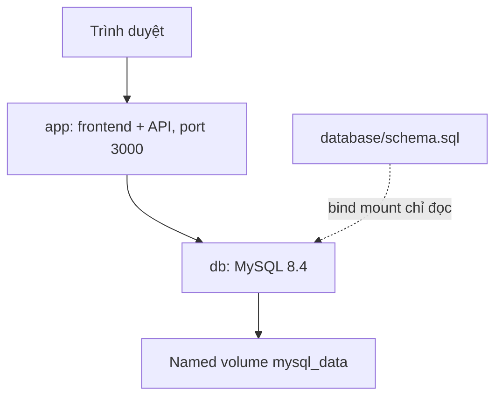
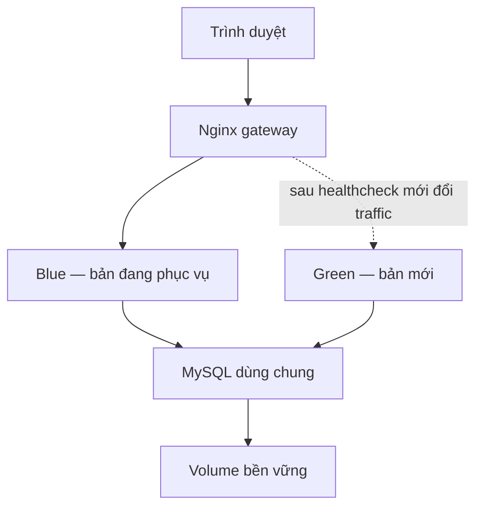

# Kiến trúc LapStore

## Local và CI

Frontend là ba file tĩnh, Express trả chúng và cung cấp API cùng origin.
Không cần container frontend riêng. `db.js` cố định host `db`, database `lapstore`,
user `lapstore`; chỉ password đọc từ môi trường. MySQL vẫn cần các biến khởi tạo
database/user/password. Hai phía phải dùng cùng `DB_PASSWORD`.

Compose tạo mạng riêng cho từng project; tên service `db` là DNS trong mạng đó.
Không mở port MySQL ra host. Named volume chứa database thật, file SQL chỉ khởi tạo.

## Runtime dùng cho CD

`compose.deploy.yml` là cấu hình riêng, không merge chồng với `compose.yml`.
Project cố định `lapstore-live`; gateway mặc định localhost:8080. Blue/green không
publish port ra ngoài. Một thời điểm Nginx chỉ chọn một slot. Hai slot dùng cùng
Dockerfile; mỗi slot có thể chạy digest khác nhau.

Trình tự: pull image mới → khởi chạy slot không nhận traffic → healthcheck thật →
so sánh Docker image ID → ghi cấu hình proxy bằng rename → nginx -t/reload →
kiểm tra /health qua gateway đúng release → commit state. Slot cũ tiếp tục chạy.
Nginx reload giữ worker cũ hoàn tất request đang xử lý. Đây là blue-green trên một
server, không phải hệ thống HA: mất server/DB/gateway vẫn gây downtime.

## State và rollback

Runtime được tạo bằng `cd/init.sh`, nằm ngoài GitHub runner workspace:

| File/thư mục runtime | Ý nghĩa |
|---|---|
| `.env` | Mật khẩu DB và port gateway, chỉ trên server |
| `state` | 4 dòng: slot hiện tại, digest hiện tại, slot trước, digest trước |
| `pending` | Dấu lần chuyển traffic chưa hoàn tất; lần chạy sau đối chiếu state |
| `deployment.lock` | `flock` ngăn deploy/rollback song song từ CLI và workflow |
| `proxy/default.conf` | Upstream Nginx được script sinh, mount cả thư mục |
| `reports/<timestamp-pid>/` | Log, thông tin release, CSV downtime của từng lần chạy |

State được ghi bằng file tạm + rename. Runtime giữ bản Compose và schema cố định;
script từ chối deploy nếu source thay hai file này. Vì vậy rollback khôi phục
image với cùng cấu hình hạ tầng; không tự rollback schema hay dữ liệu.
Migration database là công việc riêng, phải tương thích cả hai phiên bản đang chạy.

Script giữ image trước trên máy để rollback khi registry tắt. Không chạy prune
image/container tùy tiện trên runtime. Chỉ có một mức previous; sau rollback, bản
vừa rời khỏi trở thành previous để có thể đổi lại.

## Các API

| Method | URL | Kết quả |
|---|---|---|
| GET | `/health` | 200 nếu query products thành công; 503 nếu không |
| GET | `/api/products` | Danh sách |
| GET | `/api/products/:id` | Chi tiết hoặc 404 |
| POST | `/api/products` | Tạo, trả 201 và ID |
| PUT | `/api/products/:id` | Thay các trường sản phẩm, trả 200/404 |
| DELETE | `/api/products/:id` | Xóa, trả 204/404 |

Body POST/PUT: `{"name":"LapBook","category":"Học tập","quantity":3,"price":12000000}`.
Danh mục: Văn phòng, Học tập, Đồ họa, Gaming. Giá VND nguyên, không âm, tối đa
999.999.999; quantity nguyên 0–1.000.000. ID do MySQL tạo. SQL dùng tham số, frontend
escape text trước khi render. Đây không phải hệ thống thương mại điện tử có auth/payment.
